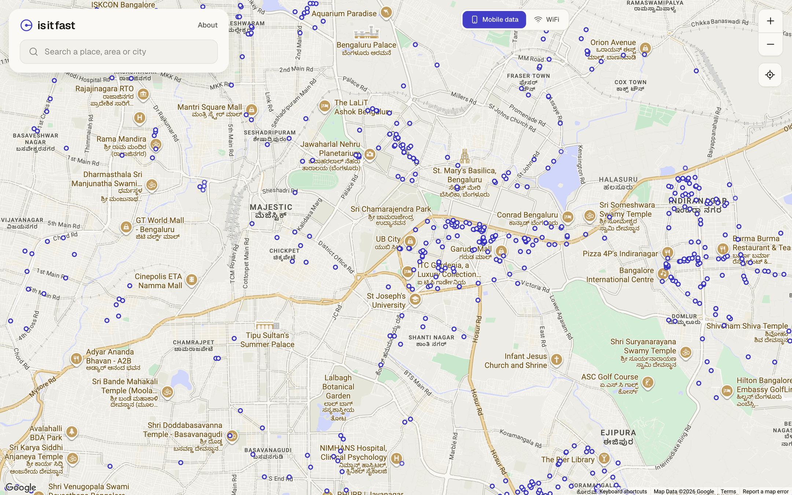
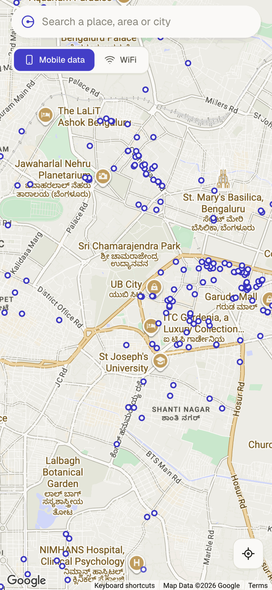
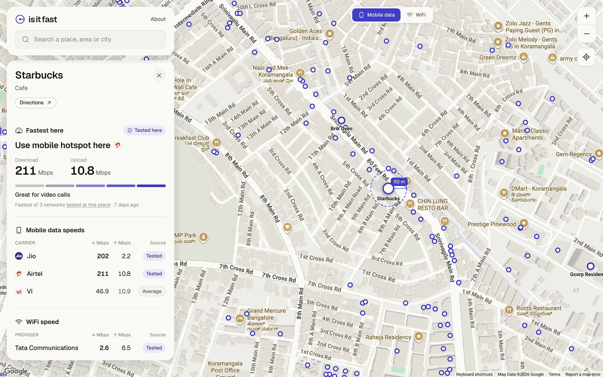
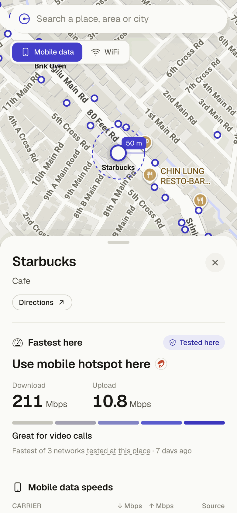

# isitfast.cloud

A map of cafes and coworking spaces showing the internet numbers that matter if you want to work from one:
WiFi and mobile-data speeds, tested in the browser by people who were actually there.

**Live: https://isitfast.cloud**

| Web | Mobile |
|---|---|
|  |  |
|  |  |

## What it shows

| In the panel | Source | Granularity | Freshness |
|---|---|---|---|
| **This place's WiFi** (latest down/up/ping, ISP, last tested) | Community tests run in the browser at the place | Per venue | Live |
| **Mobile data by carrier** | Community tests on mobile data; carrier from the visitor ASN that Cloudflare sees | Per venue | Live |
| **Mobile data (published)** (avg down/up/latency, tests, devices) | [Ookla Open Data](https://github.com/teamookla/ookla-open-data) mobile tiles, CC BY-NC-SA 4.0 | Zoom-16 tile (~610 m), all carriers combined; falls back to 3×3 tile avg | Quarterly |
| **Home/office broadband nearby** | Ookla Open Data fixed tiles | ~610 m tile | Quarterly |
| Place name, type, address (Google places) | Google Maps Places API, fetched live in the browser on open; never stored | Per venue | Live |
| Places as map dots: cafes, coworking, restaurants, offices, apartment buildings | OpenStreetMap via Overpass | Per venue | Refreshed weekly |

Every OSM place is a small dot (drawn on one canvas overlay; cafes and coworking from zoom 13, all kinds from
14.5); tested places get a labelled pin. Any Google basemap POI can be tapped and tested. Colour toggles
between mobile download (ring = area average) and community WiFi (solid = tested here).

## Architecture

```
Cloudflare (proxied; transform rule → x-visitor-asn; cache rule: GET /api/places/* respects origin headers)
  ├─ speed.isitfast.cloud  Worker (speed-worker/) — /__down, /__up with HMAC-signed byte receipts
  └─ reverse proxy → container `isitfast` :8000 (WEB_WORKERS uvicorn processes, default 3)
       FastAPI + SQLite (/data volume)
         app.db        places, community tests, test tokens, caches (ASN, geocode), metrics, job stamps
         ookla.db      Ookla mobile + fixed tiles for India, keyed by quadkey (~41 MB)
         carriers.db   M-Lab city × carrier medians
         backups/      daily VACUUM INTO snapshots (14 kept)
       Front end: vanilla JS + Google Maps JS API (vector map + Map ID, AdvancedMarkerElement pins,
                  Places API (New) details + autocomplete). Key/Map ID from GOOGLE_MAPS_KEY / GOOGLE_MAP_ID env.
       (app/basemap.py + web/vendor/maplibre-gl are the earlier self-hosted PMTiles basemap, now unused.)
```

**Read path (cache-friendly).** The map loads places as fixed 0.25° GeoJSON snapshots
(`/api/places/tile/{i}/{j}`, ETag + `max-age=60`): identical URLs for every visitor, so Cloudflare serves
most of them. A new test bumps only its tile's revision. Place cards (`/api/places/{id}`) are cached 30 s;
after your own test the client bypasses with `?fresh=`. No request ever calls Overpass.

**Write path (verified).** `POST /api/places/{id}/test-start` checks you are within 50 m, rate-limits
(30 starts / 10 tests per connection per hour, 3 per place), creates the place if it was only being
previewed, and returns a single-use HMAC token + session id. The browser tests against our Worker, which
signs a cumulative receipt every 4 MiB of download and one per upload. `POST …/tests` needs the token
(3 s–15 min old, used once) and, when receipts are present, the claimed speeds must be within 2× of what
the Worker actually transferred (download bounded by the Worker-clock download phase, upload by arrival
times). If our Worker is unreachable the test falls back to `speed.cloudflare.com` and is stored with
`verified=0`. Carrier/ISP comes only from the ASN Cloudflare saw (`x-visitor-asn`), never the client.

**Background jobs** (`entrypoint.sh`): weekly Ookla (new quarter only), M-Lab (new month only) and OSM
places for the seeded cities (`app/seed.py`, every 6 days); daily backup. Ingests build a new database
beside the live one and `os.replace()` it in, so readers never block or see half-written data. Places that
disappear from OSM get `gone_at` and are hidden unless tested; they are never deleted.

**Browsing is read-only.** Tapping any Google POI gives its `place_id`; the browser fetches its name, type and
address live (one Place Details call per open) and the server previews it at that position (id
`g<place_id>`); nothing is stored until someone at the place starts a test.

**Google places.** Only the `place_id` is stored. A Google place's row keeps no name, no Google type and no
Google coordinates: its pin position is where the first test there was run (the 50 m check compares it with
Google's position, which is not stored). A Google POI with a matching name within 100 m of a tested
OSM/visitor place opens that place instead, so tests aren't split.

**Instrumentation.** `GET /api/metrics` (header `x-metrics-token`; returns 404 when `METRICS_TOKEN` is unset)
returns per-route latency and counts, event-loop lag, threadpool saturation, SQLite lock errors, the test
funnel, outbound calls per upstream, client telemetry, row counts, file sizes and the last backup.

## Run it yourself

```sh
cp .env.example .env                                 # fill in IP_SALT, RECEIPT_KEY, GOOGLE_MAPS_KEY, …
docker compose up -d --build                         # compose joins an external proxy network; remove
                                                     # the `networks:` block and map a port for standalone
docker exec isitfast python -m app.seed              # fetch OSM places for the seeded cities
docker exec isitfast python -m app.ookla_ingest --force
```

Without Docker: `pip install -r requirements.txt` then
`uvicorn app.main:app --port 8766` with the same env vars (`DATA_DIR` for the SQLite files).

Tests: `pip install -r requirements-dev.txt && python -m pytest -q`.
Concurrency soak: `python tests/soak.py http://127.0.0.1:8766 4000 32`.

Required env (see `.env.example`): `IP_SALT` (long random; the app refuses weak/default salts),
`RECEIPT_KEY` (same value as the Worker secret), `GOOGLE_MAPS_KEY` + `GOOGLE_MAP_ID` (a Maps JS key
restricted to your domain). Local dev may set `DEV_ASN` instead of the edge header.

Speed Worker: `cd speed-worker && npx wrangler deploy` (secret: `npx wrangler secret put RECEIPT_KEY`).

Load, measured locally (M4 laptop, 3 workers, prod data copy): ~650–700 mixed req/s at 8–32 concurrent
connections with zero errors; throughput falls to ~300 req/s at 64–128 connections (one dropped
connection at 128). In production most reads are Cloudflare cache hits and never reach the origin.

## Limitations (honest)

* Ookla open data is **all carriers combined** and tile-level; it is not the cafe's indoor reality. Per-carrier and
  per-venue numbers exist only once people test there.
* The browser test measures to Cloudflare's edge (our Worker) with 6 parallel download / 4 upload connections over a
  timed window (mobile data: 4/3, capped ~75 MB down + ~25 MB up), warm-up discarded, trimmed mean, like
  Speedtest/fast.com. On a congested mobile hotspot it read ↓72.7 / ↑25.2 Mbps vs macOS `networkQuality`
  ↓70.3 / ↑33.2. Results still vary by server choice (Speedtest often picks a server inside the ISP's network).
* Network type (WiFi vs mobile) is user-selected (auto-guessed on Android Chrome).
* A tested Google place's pin sits where its first test was run, which can be up to ~50 m from Google's own icon.
* Location is client-reported: the 50 m rule stops honest mistakes, not a determined spoofer. Receipts bound
  the claimed *speed*, not *where* the test ran. Tests that fell back to speed.cloudflare.com are unverified.
* Single server + SQLite: fine far beyond today's traffic (reads are edge-cached), but writes are serialised;
  `/api/metrics` (db_error:locked, loop lag) shows when that starts to matter.

## Licence

Code: [GNU AGPL-3.0](LICENSE). If you run a modified version as a network service, you must offer its source to
its users.

Not covered by that licence (see [NOTICE.md](NOTICE.md)): carrier logos in `web/carriers/` (trademarks of
Jio, Airtel, Vi and BSNL, used only to identify networks), the speed icon `web/icons/speed-white.png`
([Icons8](https://icons8.com/icon/pEQXFEQYQHQk/speed)), the Geist font (SIL OFL 1.1) and MapLibre GL JS (BSD-3).
Ookla Open Data is CC BY-NC-SA 4.0; OpenStreetMap data is ODbL.

Security issues: see [SECURITY.md](SECURITY.md).
